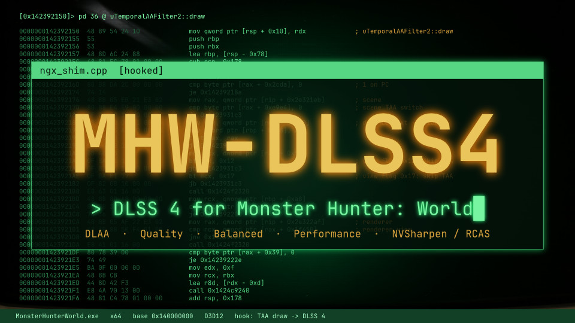
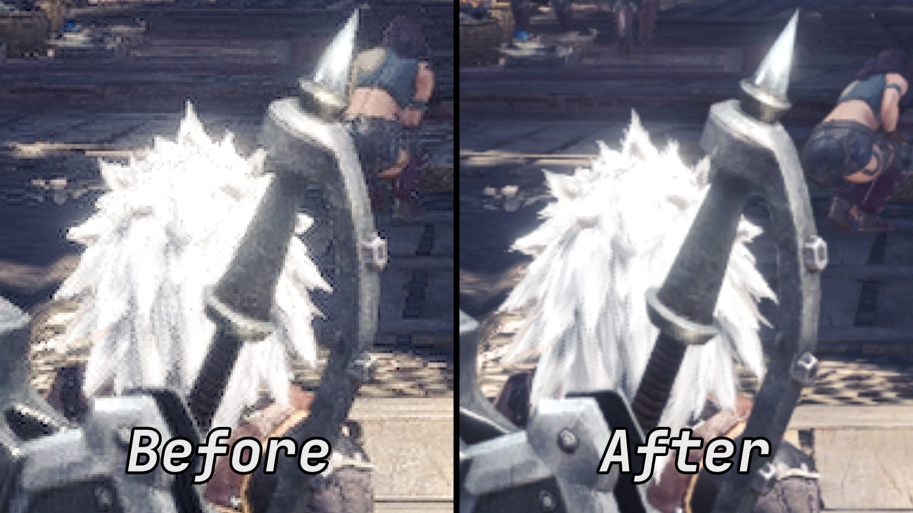
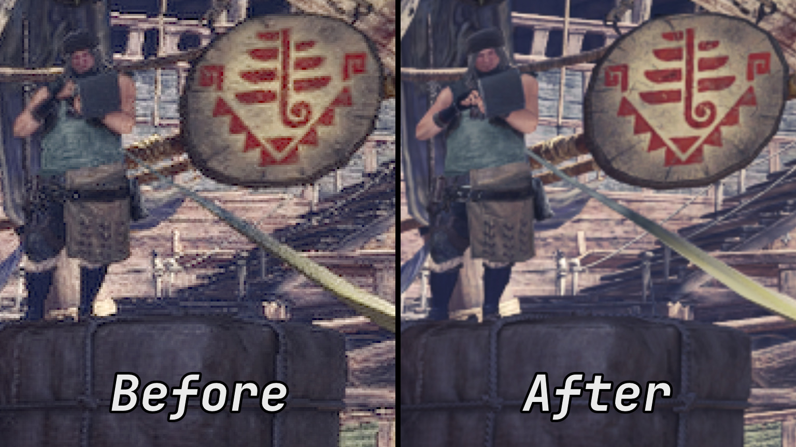

# MHW-DLSS4

A proper DLSS 4 port for Monster Hunter: World, implemented as a drag-and-drop Stracker's Loader plugin.

The game shipped with DLSS 1, which looks soft and smeary. This plugin runs current DLSS automatically: the version the NVIDIA driver has downloaded, or an `nvngx_dlss.dll` of your choice.




*Zoomed-in crops, before and after installing MHW-DLSS4.*

## Features

- **DLAA** (default): native resolution, DLSS replaces the game's TAA.
- **Quality / Balanced / Performance / Custom**: lower render resolution, DLSS scales up to the
  output resolution.
- Three sharpening filters after DLSS, set in the ini: NVIDIA's **NVSharpen** (default), **Vanilla**, or AMD's **RCAS**.
- **NVIDIA Reflex**, with or without DLSS.
- **DX12**, **DX11** and **HDR** are supported.

## Requirements

- An NVIDIA RTX GPU, plus either a current driver (it downloads DLSS for you) or an `nvngx_dlss.dll` 3.x or 4.x of your choice (see [Using a specific DLSS version](#using-a-specific-dlss-version)). 310.x (DLSS 4) is recommended.
- [Stracker's Loader](https://www.nexusmods.com/monsterhunterworld/mods/1982), or any loader that loads the DLLs in `nativePC\plugins`.

## Install

1. Extract the zip into the game folder. You get:
   ```
   nativePC\plugins\MHW-DLSS4.dll
   nativePC\plugins\MHW-DLSS4.ini
   ```
   The plugin keeps its other files in `nativePC\plugins\MHW-DLSS4\`. It copies the NVIDIA driver's DLSS file to `MHW-DLSS4\driver\nvngx_dlss.dll` automatically, and again whenever the driver gets a newer one. Never put an `nvngx_dlss.dll` directly in `nativePC\plugins`: Stracker's Loader loads every DLL there. Leave the game's own `nvngx_dlss.dll` in the game folder alone; it is no longer used, but it does no harm.
2. Start the game, set **NVIDIA DLSS** to **On** in the graphics options, and keep **Image Quality** on **High**. **Anti-Aliasing** is greyed out while DLSS is on; whatever it shows, the plugin uses the game's TAA together with DLSS and keeps FXAA off.

To uninstall, delete `MHW-DLSS4.dll`, `MHW-DLSS4.ini`, `MHW-DLSS4.log` and the `MHW-DLSS4` folder in
`nativePC\plugins`.

## Settings

You can edit `nativePC\plugins\MHW-DLSS4.ini` while the game runs; changes apply within a second (except `DLLPath`).

| Key | Values | Meaning |
| --- | --- | --- |
| `Mode` | `DLAA`, `Quality`, `Balanced`, `Performance`, `Custom` | Render resolution. The game never renders below half resolution, so there is no Ultra Performance mode (an old `UltraPerformance` setting runs as `Performance`). |
| `RenderScale` | 0.5 to 1.0 | Scale used by `Mode=Custom`. |
| `Preset` | `Default`, `J`, `K`, `L`, `M` | DLSS model preset. K is the DLSS 4 transformer; L and M are the DLSS 4.5 models meant for the performance modes. |
| `Sharpness` | 0 to 1, `Game` | Sharpening after DLSS; 0 turns it off. 0.33 (default) is moderate, 1 is strong. `Game` follows the in-game DLSS Sharpness slider on the same scale. |
| `Sharpener` | `NVSharpen`, `Vanilla`, `RCAS` | The sharpening filter, see below. |
| `DLLPath` | folder or file | The `nvngx_dlss.dll` to use. Empty (default): the one the driver has. See [Using a specific DLSS version](#using-a-specific-dlss-version). Read when the game starts. |
| `AutoExposure` | 0 / 1 | Let DLSS estimate exposure (presets L and M always do). |
| `Bypass` | 0 / 1 | DLAA mode only: show the game's TAA for comparison. |
| `LowLatency` | `Off`, `On`, `Boost` | NVIDIA Reflex, see [below](#nvidia-reflex-and-frame-rate-caps). |
| `LogLevel` | `Debug`, `Info`, `Warn`, `Error` | How much goes into `MHW-DLSS4.log` next to the plugin. |

Ini files from 0.8.1 and older also have an `[Advanced]` section: settings measured for this game,
now built in. You can delete that section.

### Sharpening

Current DLSS no longer sharpens the image, and it ignores the game's DLSS Sharpness slider. So the
plugin sharpens the image itself, right after DLSS:

- `Sharpness` sets the strength, from 0 (off) to 1 (strong). The default, 0.33, is a light touch.
- `Sharpness=Game` lets the in-game **DLSS Sharpness** slider set it instead. The new value applies
  once you apply the graphics settings in the game.

`Sharpener` picks the filter:

- **NVSharpen** (default): NVIDIA's sharpening, the same filter as the Image Sharpening option in
  the NVIDIA driver settings. A good all-rounder.
- **Vanilla**: the sharpening of the game's original DLSS, rebuilt for this plugin. It brings out
  fine texture detail more than edges, and it stays fairly mild: 1 is the strongest the original
  game allowed.
- **RCAS**: AMD's sharpening from FidelityFX Super Resolution. Similar to NVSharpen at low values,
  the strongest of the three at high values.

The same `Sharpness` gives a different amount of sharpening with each filter. These settings look
about the same:

| | NVSharpen | Vanilla | RCAS |
| --- | --- | --- | --- |
| Light | 0.33 | 0.33 | 0.25 |
| Medium | 0.66 | 0.66 | 0.5 |
| Strong | 1 | (its maximum, 1, is between medium and strong) | 0.75 |

In **Balanced** and **Performance**, the image DLSS upscales already carries fine grain from the
game's post-processing, and sharpening brings it out. Keep sharpening lower there: about 0.33 with
NVSharpen or RCAS, 0.5 with Vanilla.

Fun fact: in the original game the DLSS Sharpness slider did nothing at all. The old DLSS only
started sharpening above 1, and the slider stops at 1.

### NVIDIA Reflex and frame rate caps

The plugin adds NVIDIA Reflex to the game. It needs an NVIDIA graphics card and works with NVIDIA
DLSS on or off.

- `LowLatency=On` (default) lets the driver start each frame just in time for the graphics card.
  The game already keeps few finished frames waiting, so the gain is small: about half a
  millisecond in our tests. `Boost` also keeps the graphics card at full clock speed, for about
  2 ms less input lag and more power use.
- A frame rate cap adds input lag in this game, whichever limiter you use: the game shows a frame
  one update after it reads your input, and every update waits for the cap. In our tests (RTX 4080
  SUPER, 1440p, DLAA) the time from the mouse to the finished frame was about 15 ms at 165 fps
  without a cap and about 24 ms at 60 fps.
- Cap with the game's own Frame Rate option or with Max Frame Rate in the NVIDIA Control Panel or
  NVIDIA App; both add the same input lag as long as `LowLatency` is on. Reflex lets the driver's
  cap wait at the start of the frame; without it the driver waits later in the frame, which cost
  about 7 ms more at 60 fps in our tests.
- DLSS itself adds no input lag: DLAA measured the same as DLSS off, and the upscaling modes lower
  it, because the graphics card finishes each frame sooner.

## Using a specific DLSS version

By default the plugin uses the newest DLSS your NVIDIA driver has downloaded. To use a particular
`nvngx_dlss.dll` instead, for example an older version you prefer, one from another game or when playing on Linux:

- **Easiest:** put the DLL into `nativePC\plugins\MHW-DLSS4`. The plugin uses it when it is newer
  than the driver's.
- **Any version, newer or older:** set `DLLPath` in `MHW-DLSS4.ini` and restart the game. `DLLPath`
  can be a folder that contains `nvngx_dlss.dll`, or the DLL file itself under any name (handy for
  keeping several versions side by side).

A path without a drive letter starts in the game folder, the one with `MonsterHunterWorld.exe`
(for example `C:\Program Files (x86)\Steam\steamapps\common\Monster Hunter World`). `..\` goes one
folder up, which reaches your other games in the same Steam library. Examples:

```ini
; nvngx_dlss.dll in nativePC\plugins\MHW-DLSS4, even when the driver has a newer one
DLLPath=nativePC\plugins\MHW-DLSS4

; a renamed copy in the same folder
DLLPath=nativePC\plugins\MHW-DLSS4\nvngx_dlss_310.4.dll

; the DLSS of another game in the same Steam library
DLLPath=..\Cyberpunk 2077\bin\x64

; a full path; spaces are fine, quotes are optional
DLLPath=D:\DLSS versions\310.9\nvngx_dlss.dll
```

Never put an `nvngx_dlss.dll` directly in `nativePC\plugins`: Stracker's Loader loads every DLL
there. If the path is wrong, the log says so and the plugin falls back to the driver's DLSS.

Always use reputable sources to obtain `nvngx_dlss.dll` files, like [DLSS Swapper](https://github.com/beeradmoore/dlss-swapper), but DON'T use it to swap .dll, only for direct downloads.

## Troubleshooting

The plugin writes everything it does to `nativePC\plugins\MHW-DLSS4.log`. When something seems off,
look there first.

- **The NVIDIA DLSS option is greyed out or missing:** the log says why. Usually the GPU is not an
  RTX card, or the driver is too old.
- **The log says "no nvngx_dlss.dll" or "DLSS is not available":** the driver has not downloaded
  DLSS 3 or newer yet, and no other `nvngx_dlss.dll` was found. Put one (3.x or 4.x) into
  `nativePC\plugins\MHW-DLSS4`, or point `DLLPath` at one. DLSS 1 files do not work.
- **Which DLSS version is running?** The log line starting with `nvngx_dlss.dll:` shows the version
  and where it came from. You can also turn on NVIDIA's on-screen DLSS indicator: set the registry
  value `HKLM\SOFTWARE\NVIDIA Corporation\Global\NGXCore\ShowDlssIndicator` (DWORD) to `1024`, and
  back to `0` to hide it.
- **NVIDIA App DLSS override:** it works on top of this plugin, as in any other DLSS game.
- **The game starts in DirectX 11 after a crash:** the game switches itself to DirectX 11 after a
  graphics crash. Turn DirectX 12 back on in the graphics options.
- **Shiny metal edges look blocky in Balanced or Performance:** that is the game's own shimmering
  highlights at the lower render resolution, which DLSS cannot fully smooth out. Quality or DLAA,
  or less sharpening, helps.
- **To compare with the game's own TAA:** set `Bypass=1` in DLAA mode, and back to `0` afterwards.

## How it works

In short: the game still thinks it is running its own DLSS 1, but every DLSS call goes to the
plugin, which runs current DLSS instead. No game files or game code are changed; remove the plugin
and the game is back to normal. The technical details are in
[docs/technical.md](docs/technical.md).

## Known limitations

- In Quality, Balanced and Performance, DLSS upscales the image after the game's post-processing
  (depth of field, motion blur, tone mapping), where the game's own DLSS 1 sat. DLSS is designed to work
  before those effects, so the upscaling modes can't look quite as good as in games built for
  current DLSS.
- Texture sharpness follows the mode of the area you loaded: after changing `Mode` while playing,
  textures get the new sharpness at the next area change (or after a restart).
- In DLAA, the game's own TAA still runs underneath and its result is thrown away. That costs a
  fraction of a millisecond.

## Building from source

See [docs/technical.md](docs/technical.md#building).

## Licence

MHW-DLSS4 is released under the [BSD 2-Clause License](LICENSE): you can use, change and share it,
also as a built DLL, as long as the copyright notice and licence text come along. The DLL also
contains parts of NVIDIA's DLSS SDK, NVIDIA Image Scaling and AMD FidelityFX, which keep their own
licences (listed in `MHW-DLSS4-THIRD-PARTY.txt` in the download).
