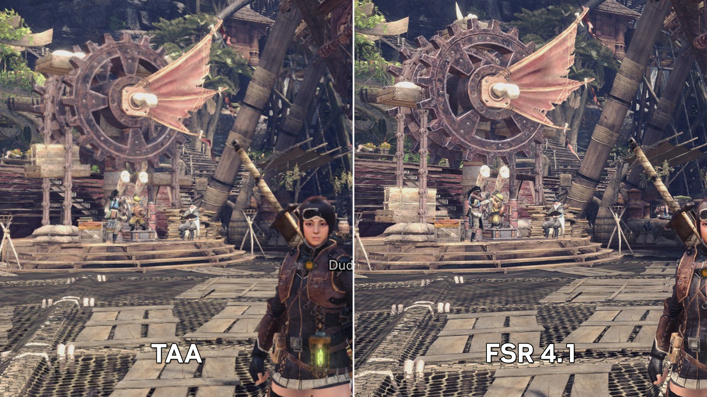

# MHW-FSR: AMD FidelityFX FSR 3.1 & 4.1 for Monster Hunter: World

**MHW-FSR** is an open-source DirectX 12 plugin for [Stracker's Loader](https://www.nexusmods.com/monsterhunterworld/mods/1982) that brings native **AMD FidelityFX FSR 3.1** and next-gen **FSR 4.1** (ML upscaler) to *Monster Hunter: World*.

By intercepting MT Framework's internal TAA pass (`uTemporalAAFilter2::Draw`) and camera projection matrices in DirectX 12, the mod replaces the legacy DLSS 1.0 implementation with modern AMD FidelityFX temporal super-resolution and anti-aliasing.

---

## Highlights

- **Universal GPU Support**: Runs natively on AMD Radeon (RDNA 1/2/3/4), Intel Arc, and NVIDIA GeForce GPUs.
- **FSR 4 ML Upgrade for RDNA 2, 3 & 4**: Automatically leverages AMD's machine-learning upscaler (**FSR 4.1.2** driver ML on RDNA 2/3/4 or **FSR 4.1.1** DirectML on RDNA 3/4), while providing high-quality **FSR 3.1.5** temporal upscaling on earlier architectures.
- **NativeAA (Default)**: Replaces MT Framework's blurry legacy TAA with crisp FSR temporal anti-aliasing at 100% native resolution.
- **True TAA-Pass Upscaling**: Quality (~1.5x), Balanced (~1.7x), Performance (2.0x), and Custom scaling execute directly inside the engine's TAA pass on linear HDR color, reversed-Z depth, dense motion vectors, and Halton sub-pixel jitter, with tonemap color-ratio preservation before HUD rendering.
- **AMD FidelityFX Anti-Lag 2**: Native driver-level integration (`amdxc64.dll`) with a built-in driver frame rate limiter.
- **In-Game Control Center & OSD**: Standalone DirectX 12 overlay built with Dear ImGui. Press **[F10]** or **[Insert]** in-game to switch presets, adjust RCAS sharpness, choose FSR 4 models, or view the GPU/CPU latency profiler.

---

## Visual Comparison



*Comparison demonstrating reconstructed details, texture clarity, and temporal anti-aliasing stability with AMD FidelityFX FSR in Monster Hunter: World.*

---

## Requirements

1. **Monster Hunter: World** (v15.23) running in **DirectX 12** mode.
2. [Stracker's Loader](https://www.nexusmods.com/monsterhunterworld/mods/1982) (supporting `nativePC\plugins\`).
3. Windows 10/11 64-bit with current graphics drivers.

### Compatibility
- **SharpPluginLoader (SPL) 2.0+**: Fully compatible out of the box (includes automated WndProc cycle prevention).
- **Stracker's Loader & Performance Booster**: Fully compatible.

---

## Installation

1. Download or extract the release archive (`MHW-FSR-<version>.zip`) into your game directory (`Monster Hunter World`):
   ```
   nativePC\plugins\MHW-FSR.dll
   nativePC\plugins\MHW-FSR.ini
   nativePC\plugins\MHW-FSR\amd_fidelityfx_loader_dx12.dll
   nativePC\plugins\MHW-FSR\amd_fidelityfx_upscaler_dx12.dll
   ```
   > **Note:** The FSR runtime binaries must stay inside `nativePC\plugins\MHW-FSR\`. Do not place them directly in `plugins\`, as Stracker's Loader will attempt to treat them as game mods.

2. Launch the game.
3. In **Options -> Title Menu -> Display -> Advanced Graphics Settings**:
   - Set **DirectX 12 API** to **On**.
   - Set **NVIDIA DLSS** to **On** (the plugin patches MT Framework's UI check so this option is unlocked on all AMD/Intel/NVIDIA cards).

---

## Configuration File (`MHW-FSR.ini`)

All settings can be configured via the in-game **[F10]** overlay or in `nativePC\plugins\MHW-FSR.ini`, which hot-reloads automatically:

```ini
; =============================================================================
; MHW-FSR - AMD FidelityFX FSR 3.1 & FSR 4.1 for Monster Hunter: World (DX12)
; =============================================================================
; Quick Start:
; 1. In game Display Settings, enable DirectX 12 API.
; 2. Turn ON "NVIDIA DLSS" (this plugin intercepts it to run AMD FSR).
; 3. Press [F10] or [Insert] in-game to open the MHW-FSR Control Center.

[General]
; 1 = Plugin enabled, 0 = Disabled completely (requires game restart).
Enabled=1

; Top-left corner status badge (OSD).
ShowOSD=1
ShowFPS=1
ShowLatencyOSD=0

; Log detail level written to nativePC\plugins\MHW-FSR.log (Debug, Info, Warn, Error).
LogLevel=Info

[FSR]
; QualityPreset: Internal rendering resolution and upscaling mode.
;   NativeAA    -> 100% native screen resolution (replaces blurry vanilla TAA).
;   Quality     -> ~1.5x scale (66.7% render resolution).
;   Balanced    -> ~1.7x scale (58.0% render resolution).
;   Performance ->  2.0x scale (50.0% render resolution).
;   Custom      -> Uses RenderScale below.
QualityPreset=NativeAA

; Used only when QualityPreset=Custom (0.50 to 1.00).
RenderScale=0.75

; Integrated post-upscale RCAS sharpening (0.00 to 1.00, or Game to follow in-game slider).
Sharpness=0.33

; Upscaler version: Auto (recommended), FSR 4.1.2, FSR 4.1.1, FSR 3.1.5, or hex ID.
Version=Auto

; FSR 4.1.2 ML model variant: Auto, Standard, INT8_2, or Lite.
Model=Auto

; Custom directory containing amd_fidelityfx_loader_dx12.dll & amd_fidelityfx_upscaler_dx12.dll.
; Leave empty to use default: nativePC\plugins\MHW-FSR\
DLLPath=

[AntiLag]
; AMD FidelityFX Anti-Lag 2 driver-level latency reduction (Radeon GPUs).
AntiLag2=1

; Driver-level framerate limiter in FPS (0 = Unlimited).
AntiLagMaxFPS=0
```

---

## Logging & Diagnostics

Detailed logs are written to:
```
nativePC\plugins\MHW-FSR.log
```
The log displays the detected GPU, active D3D12 device, queried FSR versions, selected upscaler model, and dispatch resolutions.

---

## Building from Source

### Prerequisites
- Visual Studio 2022 (with "Desktop development with C++" workload)
- CMake 3.24 or newer
- [AMD FidelityFX-SDK](https://github.com/GPUOpen-LibrariesAndSDKs/FidelityFX-SDK)

### Build Steps
```powershell
git clone https://github.com/GPUOpen-LibrariesAndSDKs/FidelityFX-SDK.git FidelityFX-SDK
git clone <this-repo> MHW-FSR
cd MHW-FSR

cmake -S . -B build -G "Visual Studio 17 2022" -A x64 -DFFX_SDK_DIR="path/to/FidelityFX-SDK"
cmake --build build --config Release
```

To automatically package or deploy into your game installation:
```powershell
.\tools\package.ps1
.\tools\deploy.ps1
```

---

## Credits & Acknowledgments

- **[odt1](https://github.com/odt1/MHW-DLSS4)** for **MHW-DLSS4**: This project is a direct fork and evolution of `MHW-DLSS4`. All original engine reverse-engineering, MT Framework TAA pass hooking, projection matrix analysis, and memory scanning techniques are credited to **odt1**.
- **[Stracker](https://www.nexusmods.com/monsterhunterworld/mods/1982)** for Stracker's Loader.
- **[wowo-dot](https://github.com/wowo-dot)** for [CMFM](https://www.nexusmods.com/monsterhunterworld/mods/8856) and [Astera Loader](https://github.com/wowo-dot/AsteraLoader).
- **[AMD FidelityFX SDK](https://github.com/GPUOpen-LibrariesAndSDKs/FidelityFX-SDK)**: AMD's open-source graphics technologies (FSR 3.1, FSR 4, and RCAS).

---

## License

This project is licensed under the BSD 2-Clause License (matching the original `MHW-DLSS4` license, copyright (c) 2026, odt1). AMD FidelityFX SDK components are copyright (c) Advanced Micro Devices, Inc. and licensed under the MIT License.
