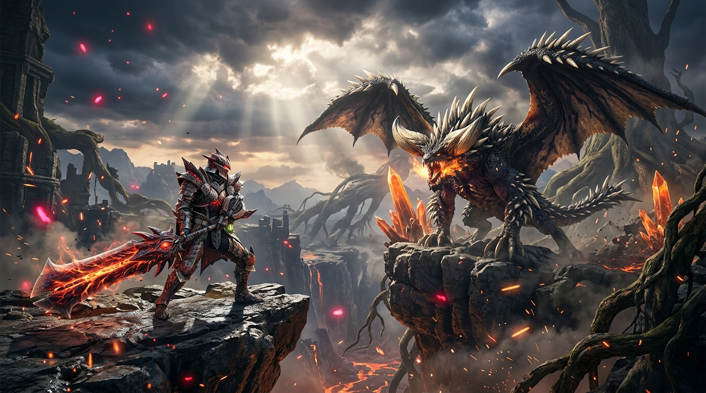
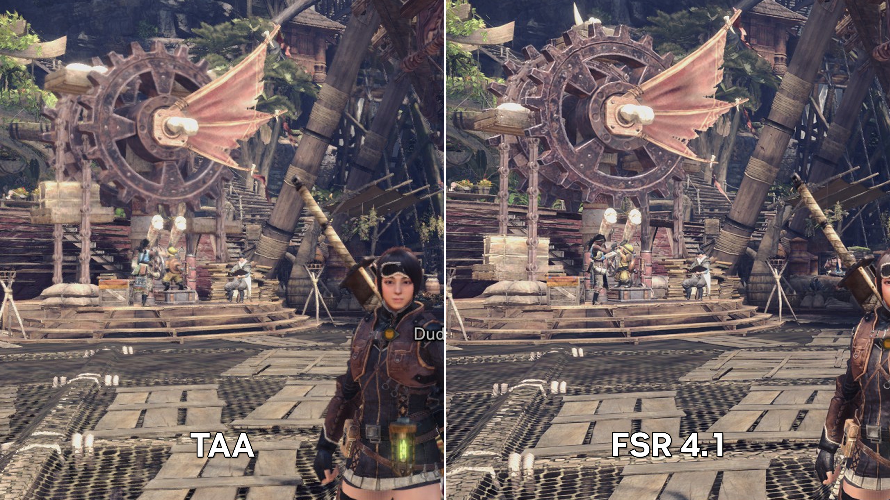

# MHW-FSR: AMD FidelityFX FSR 3.1 & 4.1 for Monster Hunter: World

**MHW-FSR** is an open-source DirectX 12 plugin for [Stracker's Loader](https://www.nexusmods.com/monsterhunterworld/mods/1982) that brings native **AMD FidelityFX FSR 3.1** and next-gen **FSR 4.1** (ML upscaler) to *Monster Hunter: World* (v15.23).

By intercepting MT Framework's internal TAA pass and camera projection matrices in DirectX 12, the mod replaces the legacy DLSS 1.0 implementation with modern AMD FidelityFX upscaling.

---

## Highlights

- **Universal GPU Support**: Runs natively on AMD Radeon (RDNA 1/2/3/4), Intel Arc, and NVIDIA GeForce GPUs.
- **FSR 4 ML Upgrade for RDNA 3 & 4**: Automatically leverages AMD's machine-learning upscaler (`FSR 4.1.1`) on RDNA 3 (e.g. RX 7000 series like RX 7700 XT) and RDNA 4 GPUs, while providing high-quality **FSR 3.1.5** temporal upscaling on earlier architectures.
- **NativeAA (Native Resolution Anti-Aliasing)**: Replaces MT Framework's blurry legacy TAA with crisp FSR temporal anti-aliasing at 100% native resolution.
- **Native In-Game Overlay & OSD**: Standalone, hardware-accelerated DirectX 12 overlay built with Dear ImGui. Press **[F10]** or **[Insert]** to open the Control Center anytime in-game.
- **Real-Time Hot-Reloading**: Seamlessly switch quality presets, customize render scales, adjust RCAS sharpness, toggle FSR architectures, or do live A/B comparisons against vanilla Capcom TAA.
- **Minimalist Corner OSD Badge**: Displays active upscaler engine, current render resolution %, framerate, and frametimes in real time.
- **Zero Conflict & Standalone**: Decoupled from third-party UI frameworks. 100% compatible with Stracker's Loader, `mhw-seamless-coop`, Performance Booster, and all popular mods.
- **Zero NVIDIA Bloat**: Clean native DirectX 12 implementation without NVNGX SDK headers or static libraries.

---

## Visual Comparison



*Comparison demonstrating reconstructed details, texture clarity, and temporal anti-aliasing stability with AMD FidelityFX FSR in Monster Hunter: World.*

---

## Requirements

1. **Monster Hunter: World** (v15.23) running in **DirectX 12** mode.
2. [Stracker's Loader](https://www.nexusmods.com/monsterhunterworld/mods/1982) (supporting `nativePC\plugins\`).
3. Windows 10/11 64-bit with current graphics drivers.

---

## Installation

1. Download or extract the release archive (`MHW-FSR-v1.2.0.zip`) into your game directory (`Monster Hunter World`):
   ```
   nativePC\plugins\MHW-FSR.dll
   nativePC\plugins\MHW-FSR.ini
   nativePC\plugins\MHW-FSR\amd_fidelityfx_loader_dx12.dll
   nativePC\plugins\MHW-FSR\amd_fidelityfx_upscaler_dx12.dll
   ```
   > **Note:** The FSR runtime binaries must stay inside `nativePC\plugins\MHW-FSR\`. Do not place them directly in `plugins\`, as Stracker's Loader will attempt to treat them as game mods.

2. Launch the game.
3. In **Options -> Title Menu -> Display -> Advanced Graphics Settings**:
   - Set **DirectX 12 API** to **On**.
   - Set **NVIDIA DLSS** to **On** (the plugin patches MT Framework's UI check so this option is enabled on all AMD/Intel cards).
   - Set **Image Quality** to **High**.

---

## In-Game Overlay & Hotkeys

Press **[F10]** or **[Insert]** at any time while playing to open the **AMD FidelityFX Control Center**.

- **Upscaling & Resolution Tab**: Switch between presets (`NativeAA 1.0x`, `Quality 1.5x`, `Balanced 1.7x`, `Performance 2.0x`, `Ultra Performance 3.0x`, `Custom`), adjust custom resolution scaling, and tune the RCAS Sharpness slider (with quick presets: Off, Subtle, Moderate, Crisp).
- **FidelityFX Core Tab**: Choose between `Auto (Recommended)`, `Force FSR 4.1.1 (DirectML)` (on supported hardware), and `Force FSR 3.1.5 (Temporal)`. Toggle dynamic auto-exposure and wet reflection history fixes.
- **Diagnostics Tab**: Instant A/B visual comparison (toggle vanilla Capcom TAA on/off to see FSR's edge clarity side-by-side), corner OSD watermark toggle, and Halton jitter telemetry.
- **Input Safety**: Automatically blocks mouse camera rotation and character movement while the menu is open.
- **Save to INI**: Click the *Save to MHW-FSR.ini* button to persist your in-game tweaks across game sessions.

---

## Configuration File (`MHW-FSR.ini`)

All settings can also be modified in `nativePC\plugins\MHW-FSR.ini`, which hot-reloads automatically:

```ini
[General]
Enabled=1          ; 1 = Plugin enabled, 0 = Disabled completely
LogLevel=Info      ; Debug, Info, Warn, or Error

[FSR]
; Presets: NativeAA, Quality, Balanced, Performance, UltraPerformance, Custom
QualityPreset=Quality

; Custom scale used when QualityPreset=Custom (0.50 to 1.00)
RenderScale=1.0

; Post-upscale RCAS sharpness (0.0 to 1.0). "Game" follows in-game slider
Sharpness=0.33

; Let FSR estimate exposure automatically (0 = off, 1 = on)
AutoExposure=0

; Upscaler version: Auto (detects best upscaler, e.g. FSR 4 on RDNA 3/4), FSR 4, FSR 3.1, or hex ID
Version=Auto

; Custom path to FSR DLLs (leave empty for nativePC\plugins\MHW-FSR\)
DLLPath=

; NativeAA only: bypass FSR to view vanilla game TAA for comparison
Bypass=0
```

---

## In-Game Configuration Menu (Optional - CMFM)

If you have [CMFM (Configuration Menu For Mods)](https://www.nexusmods.com/monsterhunterworld/mods/8856) and [Astera Loader](https://www.nexusmods.com/monsterhunterworld/mods/7212) installed:
- Simply extract the release archive into your game directory as normal. The CMFM description file (`AsteraLoader\plugins\cmfm\pages\mhw_fsr.json`) is included out of the box.
- Open the in-game pause menu (**Start -> System -> Mods -> MHW-FSR**) or the Title Screen menu (**Mods -> MHW-FSR**).
- You can switch Quality Presets on the fly, adjust the RCAS sharpness slider, toggle auto-exposure, and select upscaler versions live with full gamepad, mouse, and keyboard navigation.

---

## Logging & Diagnostics

Detailed logs are written to:
```
nativePC\plugins\MHW-FSR.log
```
The log displays the detected GPU, active D3D12 device, queried FSR versions, selected upscaler model, and per-frame dispatch resolutions.

---

## Building from Source

### Prerequisites
- Visual Studio 2022 (with "Desktop development with C++" workload)
- CMake 3.24 or newer
- [AMD FidelityFX-SDK](https://github.com/GPUOpen-LibrariesAndSDKs/FidelityFX-SDK)

### Build Steps
```powershell
git clone https://github.com/GPUOpen-LibrariesAndSDKs/FidelityFX-SDK.git FidelityFX-SDK
git clone <this-repo> MHW-FSR
cd MHW-FSR

cmake -S . -B build -G "Visual Studio 17 2022" -A x64 -DFFX_SDK_DIR="path/to/FidelityFX-SDK"
cmake --build build --config Release
```

To automatically package or deploy into your game installation:
```powershell
.\tools\package.ps1
.\tools\deploy.ps1
```

---

## Credits & Acknowledgments

- **[odt1](https://github.com/odt1/MHW-DLSS4)** for **MHW-DLSS4**: This project is a direct fork and evolution of `MHW-DLSS4`. All original engine reverse-engineering, MT Framework TAA pass hooking, projection matrix analysis, and memory scanning techniques are credited to **odt1**.
- **[Stracker](https://www.nexusmods.com/monsterhunterworld/mods/1982)** for Stracker's Loader.
- **[wowo-dot](https://github.com/wowo-dot)** for [CMFM](https://www.nexusmods.com/monsterhunterworld/mods/8856) and [Astera Loader](https://github.com/wowo-dot/AsteraLoader).
- **[AMD FidelityFX SDK](https://github.com/GPUOpen-LibrariesAndSDKs/FidelityFX-SDK)**: AMD's open-source graphics technologies (FSR 3.1, FSR 4, and RCAS).

---

## License

This project is licensed under the BSD 2-Clause License (matching the original `MHW-DLSS4` license, copyright (c) 2026, odt1). AMD FidelityFX SDK components are copyright (c) Advanced Micro Devices, Inc. and licensed under the MIT License.
